<picture>
  <source media="(prefers-color-scheme: dark)" srcset="bonsai/bonsai-dark.svg">
  
</picture>

**Targets Freya `0.5.0-rc.13`.**

---

**FreyaCN** is a design-system layer for [Freya](https://github.com/marc2332/freya).
It gives Freya three things that work as one:

- **Theming** — JSON files define every color, spacing, radius, and
  typography value. Swap the file, change the whole UI. No rebuild.
- **Styling** — a Tailwind-inspired utility vocabulary, available both as
  fluent builder methods (`Style::default().bg(blue_500()).p_4()`) and as
  parsed class strings (`.style("bg-blue-500 p-4 hover:bg-blue-700")`).
- **Elements** — HTML-like primitives (`div`, `input`, `button`, `checkbox`,
  `radio`, `text`, `p`, `image`) pre-wired to the same style cascade, so a
  rule written once works everywhere.

The layers share one `Style` struct, one variant-precedence model, and one
inheritance chain — which is what makes a design system feel coherent
instead of a stack of disconnected utilities. Start with the bundled
`default-dark` theme, swap in a Material-inspired one, or ship your own JSON
file; the API stays the same.

> ⚠️ **Pre-release.** The public API is not yet stable. Breaking changes may
> land in any `0.x` release. Pin to a specific commit or tag for anything you
> intend to keep working.

# Core Ideas

**FreyaCN** is built on two ideas. The theming, the utility strings, the
multi-design-system support — all of it falls out of these two.

1. **Theme-first** — Themes are data, loaded from JSON, not compiled in.
2. **Tailwind-inspired** — You style with utility strings and state modifiers
   you already know.

---

## Theme-first

A theme is a JSON file. If it isn't in the JSON, it isn't in the design.

**FreyaCN** resolves every visual decision — color, spacing, radius,
typography, gradients, shadows, motion, z-index — through a theme loaded at
runtime. Styles never name a hex code; they name a semantic token. Ship the
same binary with `default-dark.json` or `my-brand.json` and the UI changes.

```rust
use freyacn::prelude::*;

// Load a JSON theme and provide it to the current subtree.
let themes = use_init_theme_registry(include_str!("../themes/default-dark.json"));

// Read a token anywhere below it.
let theme = use_cn_theme();
let t = theme.read();

rect()
.background(t.background_fill())     // Fill (solid or gradient)
.color(t.foreground())               // Color
.corner_radius(t.radius("lg"))       // f32
.padding(t.spacing("4"));            // f32
```

Themes are loadable from disk (`use_init_theme_registry_from_dir`), swappable
at runtime (`themes.set_active("default-light")?`), reloadable without a
rebuild (`themes.reload_dir(path)?`), and validated on load (missing required
tokens and low-contrast pairs produce warnings on stderr — they never fail the
load).

## Tailwind-inspired

The syntax you know. No build pipeline you don't.

**FreyaCN** adopts Tailwind's mental model — composable utility strings —
without adopting Tailwind's toolchain. Utilities are implemented either as
builder methods (`StyledExt`) or as parsed class strings (`StyledString`).

A styled string looks like this:

```
bg-blue-500 text-lg px-4 py-2 rounded-md hover:bg-blue-700
```

### Usage example

#### Builder methods

```rust
use freyacn::prelude::*;

let style = Style::default ()
.bg(blue_500())
.text_color(cyan_50())
.p_4();
```

#### Parsed class string

```rust
use freyacn::prelude::*;

let style = Style::default ()
.style("bg-blue-500 text-cyan-50 p-4");
```

Both forms produce the same `Style`. Pick whichever reads better at the call
site; the two are fully interchangeable.

No CSS file. No purge step. No class-name mangling. The utility string is the
API. Anyone who has written Tailwind is productive on day one, and nobody has
to learn a bespoke styling DSL.

---

# Theming

## What a theme is

Every theme is a single JSON document with a stable, documented shape:

```json
{
  "id": "default-dark",
  "name": "Default Dark",
  "appearance": "dark",
  "version": "1.0.0",
  "author": "FreyaCN",
  "palette": {
    "brand.500": "#7c3aed",
    "brand.600": "#6d28d9"
  },
  "semantic": {
    "background": "{neutral.950}",
    "foreground": "{neutral.50}",
    "card": "{neutral.900}",
    "cardForeground": "{neutral.50}",
    "popover": "{neutral.900}",
    "popoverForeground": "{neutral.50}",
    "primary": "{neutral.50}",
    "primaryForeground": "{neutral.900}",
    "secondary": "{neutral.800}",
    "secondaryForeground": "{neutral.50}",
    "muted": "{neutral.800}",
    "mutedForeground": "{neutral.400}",
    "accent": "{neutral.800}",
    "accentForeground": "{neutral.50}",
    "destructive": "{red.600}",
    "destructiveForeground": "{neutral.50}",
    "border": "{neutral.50}/10",
    "input": "{neutral.50}/15",
    "ring": "{neutral.500}",
    "disabled": "{neutral.800}",
    "disabledForeground": "{neutral.500}"
  },
  "components": {
    "button": {
      "primary": {
        "background": "{semantic.primary}",
        "foreground": "{semantic.primaryForeground}",
        "hover": {
          "background": "{neutral.200}"
        },
        "active": {
          "background": "{neutral.300}"
        },
        "disabled": {
          "background": "{semantic.disabled}",
          "foreground": "{semantic.disabledForeground}"
        }
      }
    }
  },
  "radius": {
    "sm": 6,
    "md": 8,
    "lg": 10,
    "xl": 14
  },
  "spacing": {
    "1": 4,
    "2": 8,
    "3": 12,
    "4": 16
  },
  "typography": {
    "fontFamily": {
      "sans": "Inter, system-ui, sans-serif"
    },
    "fontSize": {
      "sm": [
        12,
        16
      ],
      "base": [
        16,
        24
      ],
      "lg": [
        18,
        28
      ]
    },
    "fontWeight": {
      "normal": 400,
      "medium": 500,
      "bold": 700
    }
  },
  "shadows": {
    "sm": "0 1px 2px rgba(0,0,0,0.05)",
    "md": "0 4px 6px rgba(0,0,0,0.1)"
  },
  "motion": {
    "duration": {
      "fast": 150,
      "normal": 250
    },
    "easing": {
      "standard": "cubic-bezier(0.2, 0, 0, 1)"
    }
  },
  "zIndex": {
    "modal": 1000,
    "tooltip": 1100
  }
}
```

Only `id`, `name`, `appearance`, and `semantic` are required. Everything else
is optional and falls back to sensible defaults. `semantic` itself should
contain the standard token set (see below); missing tokens emit validation
warnings but do not fail the load. Two ready-to-use themes —
`default-dark.json` and `default-light.json` — ship alongside the crate and
include the full recommended token set.

## Semantic tokens

`semantic` is the theme's public vocabulary. Any key you put in it becomes
addressable as `theme.<key>()` (returns `Color`) or `theme.<key>_fill()`
(returns `Fill`, so gradients work too). FreyaCN ships with named getters for
the standard set:

- `background`, `foreground`
- `card`, `card_foreground`
- `popover`, `popover_foreground`
- `primary`, `primary_foreground`
- `secondary`, `secondary_foreground`
- `muted`, `muted_foreground`
- `accent`, `accent_foreground`
- `destructive`, `destructive_foreground`
- `border`, `input`, `ring`
- `disabled`, `disabled_foreground`
- `sidebar`, `sidebar_foreground`, `sidebar_primary`, `sidebar_primary_foreground`,
  `sidebar_accent`, `sidebar_accent_foreground`, `sidebar_border`, `sidebar_ring`
- `chart_1` … `chart_5`

Each has a matching `_fill` variant for gradient support. Any extra key you
add is available via `theme.color("myToken")` / `theme.fill("myToken")`.

## Palette references

Every color value can be written in one of these forms:

| Form                                          | Example                |
|-----------------------------------------------|------------------------|
| Hex                                           | `"#ffffff"`            |
| Palette reference                             | `"{blue.500}"`         |
| Palette reference + alpha suffix              | `"{neutral.950}/24"`   |
| Semantic reference (inside `components` only) | `"{semantic.primary}"` |

Palette references resolve against the full Tailwind scale built into
`colors.rs` — `stone`, `mauve`, `olive`, `mist`, `taupe`, `slate`, `gray`,
`zinc`, `neutral`, `red`, `orange`, `amber`, `yellow`, `lime`, `green`,
`emerald`, `teal`, `cyan`, `sky`, `blue`, `indigo`, `violet`, `purple`,
`fuchsia`, `pink`, `rose` — plus `white`, `black`, and `transparent`.

The `/NN` suffix is a percentage (0–100): `{neutral.50}/10` is white at 10%
opacity. Alpha suffixes work on solid colors and palette references, not on
gradients.

**`palette` overrides.** A theme may declare its own palette entries at the top
level. Keys are `"group.step"` and values are hex strings; they take precedence
over the built-in scale and can be referenced with `{group.step}` like any
other palette entry.

**`{semantic.*}` references.** These resolve inside `components` (where the
already-resolved `semantic` map is available) but **not** inside `semantic`
itself — semantic tokens are resolved eagerly at load time, and self-references
would be circular. Use plain palette refs or hex inside `semantic`.

## Gradients

`linear`, `radial`, and `conic` gradients are first-class citizens of the
token grammar:

```json
"heroGradient": {
  "linear": {
    "angle": 135,
    "stops": [
      {
        "color": "{blue.700}",
        "at": 0
      },
      {
        "color": "{violet.600}",
        "at": 100
      }
    ]
  }
}
```

Read them back with `theme.fill("heroGradient")` — you get a `Fill` that maps
directly onto Freya's `LinearGradient`, `RadialGradient`, or `ConicGradient`.
`{palette.step}` references inside gradient stops resolve normally;
`{semantic.*}` references inside stops are not currently supported (use palette
refs or hex there). Shader fills and `RenderCallback` fills remain Rust-only,
since they cannot be serialized to JSON.

> **Note:** `radial` and `conic` accept `center` and (for radial) `radius`
> fields for forward compatibility, but Freya's gradient types currently only
> consume angle and stops. Those fields are parsed and ignored.

## Component tokens

`components` is free-form. Nest as deep as your component tree needs. Each
leaf is a token value — a color reference, a gradient object, a number, or a
keyword — resolved lazily through dotted paths:

```rust
t.component("button.primary");                  // Option<&serde_json::Value>
t.component_color("button.primary.background"); // Option<Color>
t.component_fill("button.primary.background");  // Option<Fill>
t.component_radius("button.primary.radius");    // Option<f32>

// State-aware variants:
t.state_color("button.primary", ComponentState::Hover, "background");
t.state_fill("button.primary", ComponentState::Hover, "background");
t.state_radius("button.primary", ComponentState::Hover, "radius");
```

`component_radius` accepts either a number or a string naming a key in the
theme's `radius` map.

`state_*` looks up `button.primary.hover.background` first, then falls back to
`button.primary.background`. Precedence (e.g. `active` over `hover`) is the
caller's responsibility — pass exactly one `ComponentState`.

The `ComponentState` enum mirrors gpui-kit's state model:

```
Base, Hover, Active, Focus, FocusVisible, Disabled,
Checked, Indeterminate, Selected, Pressed, Open
```

A component defines its own variants in JSON:

```json
"button": {
  "primary": {
    "background": "{semantic.primary}",
    "foreground": "{semantic.primaryForeground}",
    "hover": {
      "background": "{neutral.200}"
    },
    "active": {
      "background": "{neutral.300}"
    },
    "disabled": {
      "background": "{semantic.disabled}",
      "foreground": "{semantic.disabledForeground}"
    }
  },
  "destructive": {
    "background": "{semantic.destructive}",
    "foreground": "{semantic.destructiveForeground}",
    "hover": {
      "background": "{red.500}"
    }
  }
}
```

No schemas to maintain, no code to regenerate. Adding a new component to the
theme is adding a new key to the JSON.

## Loading a theme

Three entry points, in increasing level of control:

```rust
// From a bundled string (the common case). Installs the theme as the
// thread-local active theme and provides reactive state to the subtree.
let themes = use_init_theme_registry(include_str!("../themes/default-dark.json"));

// From a directory of `.json` files. Auto-activates the first one loaded.
let themes = use_init_theme_registry_from_dir(std::path::Path::new("themes"));

// Or manage the registry yourself. Note: this does *not* install the theme
// into Freya's context or the thread-local active theme — it is for
// standalone token resolution (tests, tooling, previews).
let registry = ThemeRegistry::new();
registry.load(include_str!("../themes/default-dark.json")) ?;
registry.load(include_str!("../themes/default-light.json")) ?;
registry.set_active("default-light") ?;
```

The two `use_init_*` functions return a `ThemeHandle`, which bundles the
registry with Freya's reactive `State<Arc<Theme>>` and is what you want inside
a component tree.

`ThemeRegistry::load` validates each theme on load: missing required semantic
tokens and low-contrast `foreground`/`background` pairs are reported to stderr
as warnings, but never fail the load.

For lower-level use, `Theme::from_json_str` and `Theme::from_config` parse and
resolve a single theme without touching the registry.

## Switching themes

`ThemeHandle::set_active` updates all three pieces of the theme system
atomically:

```rust
themes.set_active("default-light") ?;
```

- The **thread-local active theme** is swapped, so the next `Style::default()`
  reads the new colors.
- The **`State<Arc<Theme>>`** is bumped, so any component that subscribes via
  `use_cn_theme()` re-renders against the new values.
- The registry's internal active id is updated.

All three are needed. `Style::default()` gives new elements the right baseline;
`use_cn_theme()` gives existing elements a reason to rebuild their `Style`.

> The raw `ThemeRegistry::set_active` only updates the registry's active id.
> Use it for token resolution outside Freya; use `ThemeHandle::set_active`
> inside the UI.

## Hot reload

```rust
themes.reload_dir(std::path::Path::new("themes")) ?;
```

Re-reads every `.json` in the directory and replaces the loaded themes in
place. The currently active theme is refreshed automatically if it changed on
disk. There is no watcher thread by default — wire `reload_dir` to a `notify`
handle, a keyboard shortcut, or your dev-tool of choice.

> Removed files are not pruned from the registry. Call `registry.remove(id)`
> first if you need to drop a theme.

## Reading tokens in components

Colors, radii, and spacing are all available through named getters:

```rust
use freyacn::prelude::*;

fn Card() -> Element {
    let theme = use_cn_theme();
    let t = theme.read();

    rect()
        .background(t.card_fill())
        .color(t.card_foreground())
        .corner_radius(t.radius("lg"))
        .padding(t.spacing("4"))
        .child(/* ... */)
}
```

`Style::default()` seeds `background` and `text_color` from the active theme
automatically — every element inherits the theme's baseline without any code.
Explicit `.bg(..)` / `.text_color(..)` calls (or `.bg_token(..)` below)
override that default:

```rust
// Without any StyledExt calls, the rect is already themed.
rect().child(label().text("Hi"));

// This overrides the theme default.
rect().bg(blue_500()).text_color(neutral_50());

// This asks the theme for a specific token.
rect().bg_token( & t, "primary");
```

`Style::bare()` gives you a `Style` with no theme influence at all — handy for
tests, snapshots, and previews. `Style::themed(&Theme)` builds one from an
explicit theme, ignoring the thread-local.

When no theme has been installed at all, `Style::default()` falls back to
`Theme::empty_light()` so it never panics (useful in headless tests).

Convenience helpers:

```rust
// Clone the current theme value out of the reactive state.
let theme: Arc<Theme> = use_theme();

// Like `use_cn_theme()`, but falls back to the empty light theme when no
// provider exists instead of panicking.
let theme = get_cn_theme_or_default();
```

At a lower level, the thread-local active theme can be read or written
directly:

```rust
set_active_theme(Arc::new(my_theme));
let current: Arc<Theme> = active_theme();
```

## Themed builder helpers

`ThemedExt` extends `StyledExt` with token-path lookups so you don't have to
unwrap `Option`s at every call site:

```rust
rect()
.bg_token( & t, "primary")                     // semantic → Fill
.text_token( & t, "primaryForeground")         // semantic → Fill
.radius_token( & t, "lg")                      // radius map → f32
.p_token( & t, "4")                            // spacing map → f32
.gap_token( & t, "2")
.hover({
let t = t.clone();
move | s | s.bg_component( & t, "button.primary", ComponentState::Hover, "background")
})
.active({
let t = t.clone();
move | s | s.bg_component( & t, "button.primary", ComponentState::Active, "background")
});
```

The state-variant closures capture the theme by `Arc` (cheap — the handle is
already shared), so they see the current theme every time the closure runs.

## Migration from the old API

The shadcn-shaped `Theme::dark().neutral().theme_color("blue")` API has been
removed. The equivalent today is loading a JSON file whose `semantic` block
declares what `primary`, `background`, etc. should point at. If you need to
express a palette override that used to be `theme_color("blue")`, put a
`{blue.NNN}` reference directly in the semantic block or add a `palette`
override section at the top of the JSON.

The old `Colors` struct is gone — palette lookups now go through the functions
in `colors.rs` (`blue_500()`, `neutral_950()`, …) and resolve to `StyledColor`.

---

# State variants

Both `StyledExt` and `StyledString` support pseudo-state patches — `hover:`,
`focus:`, `focus-visible:`, `focus-within:`, `active:`, `disabled:`,
`checked:`, `selected:`.

```rust
use freyacn::prelude::*;

// Fluent
let style = Style::default ()
.bg(blue_500())
.p_4()
.hover( | s| s.bg(blue_700()))
.focus( | s| s.bg(blue_600()));

// Class string
let style = Style::default ().style(
"bg-blue-500 p-4 hover:bg-blue-700 focus:bg-blue-600"
);
```

The invariant that keeps this sane: **rebuild the base `Style` every render,
apply the live variant set to a clone for that pass only.** Ending a variant
is the absence of an entry in the next render — there is no "un-hover"
callback, and precedence between overlapping variants is fixed (`disabled` >
`active` > `checked` > `selected` > `focus-within` > `focus-visible` >
`focus` > `hover`). See the `styling` module docs for the full explainer.

Variant closures can read theme tokens just as easily as base styles — wrap
the theme in `move |s| s.bg_component(&theme, path, state, field)` to resolve
a state token against the JSON at the moment the variant fires.

---

# Additional API surface

A quick reference for the pieces not covered above.

### `Theme`

```rust
impl Theme {
    pub fn from_json_str(s: &str) -> Result<Self, ThemeError>;
    pub fn from_config(cfg: ThemeConfig) -> Result<Self, ThemeError>;
    pub fn empty_light() -> Self;

    // Semantic
    pub fn fill(&self, key: &str) -> Option<Fill>;
    pub fn color(&self, key: &str) -> Option<Color>;

    // Scales
    pub fn radius(&self, key: &str) -> f32;   // defaults to 8.0
    pub fn spacing(&self, key: &str) -> f32;  // defaults to 0.0

    // Component tokens
    pub fn component(&self, path: &str) -> Option<&serde_json::Value>;
    pub fn component_color(&self, path: &str) -> Option<Color>;
    pub fn component_fill(&self, path: &str) -> Option<Fill>;
    pub fn component_radius(&self, path: &str) -> Option<f32>;

    pub fn state_color(&self, path: &str, state: ComponentState, field: &str) -> Option<Color>;
    pub fn state_fill(&self, path: &str, state: ComponentState, field: &str) -> Option<Fill>;
    pub fn state_radius(&self, path: &str, state: ComponentState, field: &str) -> Option<f32>;

    // Validation (returns warnings, never fails)
    pub fn validate(&self) -> Vec<String>;

    // Plus the named getters listed under "Semantic tokens"
}
```

`Theme` derives `Clone`, `Debug`, and `PartialEq`. `Appearance` is
`Light` / `Dark`, serialized as lowercase strings.

### `ThemeRegistry`

```rust
impl ThemeRegistry {
    pub fn new() -> Self;
    pub fn load(&self, json: &str) -> Result<Arc<Theme>, ThemeError>;
    pub fn load_dir(&self, dir: &Path) -> Result<usize, ThemeError>;
    pub fn reload_dir(&self, dir: &Path) -> Result<usize, ThemeError>;
    pub fn get(&self, id: &str) -> Option<Arc<Theme>>;
    pub fn active(&self) -> Option<Arc<Theme>>;
    pub fn set_active(&self, id: &str) -> Result<(), ThemeError>;
    pub fn remove(&self, id: &str) -> Option<Arc<Theme>>;
    pub fn list(&self) -> Vec<Arc<Theme>>;
    pub fn ids(&self) -> Vec<String>;
}
```

### `ThemeHandle`

```rust
pub struct ThemeHandle {
    pub registry: Arc<ThemeRegistry>,
    pub active: State<Arc<Theme>>,
}
```

### `ThemeError`

```rust
pub enum ThemeError {
    Json(serde_json::Error),
    Io(std::io::Error),
    InvalidHex(String),
    InvalidPaletteRef(String),
    UnknownPaletteStep(String),
    UnknownTheme(String),
    NotASolidColor(String),
}
```

### Low-level resolution

`resolve_color` and `resolve_fill` are exposed for tooling and tests that need
to resolve token strings without building a full `Theme`:

```rust
pub fn resolve_color(
    s: &str,
    overrides: &HashMap<String, Color>,
    semantic: &HashMap<String, Fill>,
) -> Result<Color, ThemeError>;

pub fn resolve_fill(
    token: &TokenValue,
    overrides: &HashMap<String, Color>,
    semantic: &HashMap<String, Fill>,
) -> Result<Fill, ThemeError>;
```

---

# Installation

### Latest published version

```toml
[dependencies]
freyacn = "0.2.2"
```

> The crates.io release may lag behind `git`. Because the API is pre-release,
> pin to a specific commit for anything you intend to keep working.

### From GitHub main branch

```toml
[dependencies]
freyacn = { git = "https://github.com/brightmadueke/freyacn" }
```

### From a GitHub tag

```toml
[dependencies]
freyacn = { git = "https://github.com/brightmadueke/freyacn", tag = "v0.3.0" }
```

### From a specific commit (recommended for reproducibility)

```toml
[dependencies]
freyacn = { git = "https://github.com/brightmadueke/freyacn", rev = "<commit-sha>" }
```

### From the experimental branch

```toml
[dependencies]
freyacn = { git = "https://github.com/brightmadueke/freyacn", branch = "experimental" }
```

> **NOTE:** the `experimental` branch is not stable — it contains code that has
> not been released.

---

## License

MIT.

---

## Acknowledgements

- [Freya](https://github.com/marc2332/freya) — for the GUI framework.
- [Tailwind CSS](https://tailwindcss.com) — for the utility-first philosophy.
- [gpui-kit](https://github.com/zed-industries/zed) — for the theme-token
  model (`semantic` → `components` → `state` with fallback).
